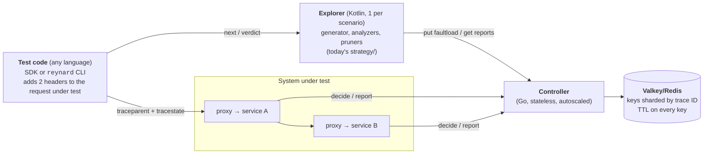

# Proposal: serverless, scalable, language-agnostic Reynard

Status: draft, 2026-11-01

## Summary

- **Proxies hold no state.** For each request, a proxy asks the controller "what is my ID, and should I fail?". Faultloads are no longer pushed to proxies, so `PROXY_LIST`, the control port and the fan-out all go away. A service can run any number of proxy instances.
- **The controller becomes a stateless function** on top of a key-value store (Valkey/Redis). The store is keyed and sharded by trace ID, and TTLs replace cleanup calls.
- **The exploration engine becomes its own process with a small HTTP API.** A test in any language can drive it with about 100 lines of client code, or with no code at all through a CLI that passes the headers as environment variables.
- **Languages:** Go for the proxy and controller (keep), Kotlin on the JVM for the explorer (migrate from Java gradually), and thin native SDKs for each test framework.

## What blocks this today

| Today | Why it blocks serverless, scale or other languages |
|---|---|
| The controller keeps reports, counters and trace IDs in process memory ([store/](../instrumentation/controller/store/)) | Only one instance can run, and its state is lost when a function is recycled |
| The controller pushes each faultload to every proxy in a static `PROXY_LIST` ([register_faultload.go](../instrumentation/controller/endpoints/register_faultload.go)) | Serverless proxies autoscale, cannot be addressed, and come and go |
| Each proxy keeps registered faults in its own memory ([control/](../instrumentation/proxy/control/)) | When a service has N instances, a request can land on an instance that never got the faultload |
| Cleanup depends on an explicit unregister call | A test runner that gets killed leaks its state forever |
| Exploration is built into the JUnit extension ([FiTestExtension.java](../library/src/main/java/dev/reynard/junit/FiTestExtension.java)) | Only JVM tests can use Reynard |

## Architecture

As today, every run is isolated by its own trace ID. That isolation is what makes sharding possible.

### 1. The proxy asks instead of being told

The per-request call `POST /v1/proxy/get-uid` becomes `POST /v2/proxy/decide`, which returns `{uid, fault}`. `fault` is null when nothing should be injected. The controller already computes the UID, so it can match the UID against the trace's faultload at no extra cost, using the same shared `FaultUid.Matches`.

- The hot path stays at two controller calls per intercepted request (`decide` and `report`), the same as today.
- Requests without `fit=1` in `tracestate` still pass through without any controller call.
- Run flags (`maskpyld`, `hashbody`, `usepred`, `hdrlog`) move out of `tracestate` into the stored faultload, and come back in the `decide` response. The proxy always sends the payload hash, and the controller ignores it when masking is on. The header keeps only `fit`, `init` and the parent of the current hop, down from up to seven keys, well within the W3C limit of 32 entries.
- Proxy configuration shrinks to `TARGET`, `SERVICE_NAME` and `CONTROLLER_URL`. The proxy control server, `RegisteredFaults`, the unused in-flight tracker and the controller's fan-out are deleted.

### 2. A stateless controller on a shared store

| State | Store key (`{t}` = trace ID) | Replaces |
|---|---|---|
| faultload and run flags | `{t}:faultload` | `TraceUIDStore`, proxy `RegisteredFaults` |
| reports | `{t}:reports` (hash: span ID → report) | `ReportStore` |
| invocation counters | `{t}:count:<point>` via `INCR` | `TraceInvocationCounter` |

- `{t}` is a Redis hash tag, so every key of a trace lands in the same cluster slot. Multi-key updates stay atomic, and the store scales out by adding shards.
- Every key has a TTL (for example 1 day, refreshed on write). Unregistering becomes optional, and a crashed runner leaks nothing.
- Every major cloud offers a managed serverless version (ElastiCache Serverless, Memorystore, Upstash). Locally, the store is one container.

### 3. The explorer as a process with a small API

The explorer is today's `strategy/` package plus `StrategyRunner`, taken out of the JUnit extension. It runs once per scenario as a short-lived job (a CI step, Kubernetes Job or Cloud Run Job), not as a request-serving function. Its search state is large, lives in memory, and only needs to last as long as the scenario.

| Call | Purpose |
|---|---|
| `POST /v2/sessions` `{name, config}` | Starts exploring one scenario. `config` holds today's `@FiTest` options. |
| `POST /v2/sessions/{id}/next` | Returns `{run_id, headers}` for the next run, or `204` when the exploration is done. |
| `POST /v2/sessions/{id}/runs/{run_id}` `{passed, message}` | Records the verdict. The explorer then fetches the trace and updates its search. |
| `GET /v2/sessions/{id}/report` | Returns statistics and counterexamples (today's reporter output). |

What a test author does, in any language: **attach the two headers to the request under test, and report whether the invariant held.** There are three ways to integrate:

1. **CLI, no code:** `reynard explore --name checkout -- pytest tests/test_checkout.py` runs the command once per faultload with `REYNARD_TRACEPARENT` and `REYNARD_TRACESTATE` set. The exit code is the verdict. The cost is one process start per run.
2. **Thin SDK (about 100 lines each):** a pytest plugin, a vitest/jest helper or a Go `testing` helper that calls `next` and posts the verdict in a loop, in-process.
3. **JVM:** `@FiTest` stays and runs the explorer in-process, so current users see no change.

The explorer ships as a container image and as a GraalVM native binary, so users outside the JVM never install Java.

## Language per component

| Component | Language | Why |
|---|---|---|
| Proxy (data plane, on every request) | **Go** (keep) | It is efficient enough that the controller round-trip, not the proxy, dominates latency. It is a small static binary that starts in milliseconds, and the standard library supports HTTP/1.1, h2c and gRPC directly. A Rust rewrite would only buy lower tail latency (no GC), at a large cost. |
| Controller (coordination) | **Go** (keep) | It shares the fault model, UID building and matching with the proxy ([shared/](../instrumentation/shared/)), so the semantics both must agree on have one implementation. A stateless HTTP handler fits any FaaS platform. |
| Explorer (search strategy) | **Kotlin on the JVM** (migrate from Java 17) | This is where Reynard's complexity lives: set algebra over fault combinations, implication stores and pruning. Kotlin adds sealed and data classes, null safety and concise immutable collections. It compiles alongside the existing ~4.3k lines of strategy code, so migration happens file by file, not as a rewrite, and the JIT keeps the combinatorics fast. |
| Test SDKs | **each target language** | Deliberately trivial (an HTTP client plus a test-framework hook), so they are cheap to write and keep in sync. |

Alternatives for the explorer:

- **Python:** expressive and common in testing, but slow on large search spaces, and it would mean a full rewrite.
- **Rust:** fast, but graph- and set-heavy research code fights the borrow checker.
- **Scala:** expressive, but has a smaller talent pool and a heavier build.
- **Java 21 (records, sealed interfaces, pattern matching):** the fallback if the team prefers no new language.

## Proxy deployment targets

One Go core and one image, with three thin entrypoints:

| Platform | Deployment |
|---|---|
| Kubernetes, Knative, ECS Fargate, Cloud Run | A sidecar container in front of the app port, as today. The platform terminates TLS, so the proxy still sees plaintext. |
| AWS Lambda (HTTP apps) | A Lambda extension layer placed behind AWS Lambda Web Adapter: adapter → proxy → app on localhost. |
| Envoy-based meshes and gateways (Istio, Envoy Gateway) | The same core runs as an Envoy `ext_proc` gRPC service, so no extra sidecar is needed per service. |

## Migration (each step ships on its own)

1. **Controller on a store.** Port the three in-memory stores to Valkey with TTLs, behind the existing v1 endpoints, and add `/v2/proxy/decide`. Nothing breaks for current users.
2. **Stateless proxy.** The proxy calls `decide`. Delete the proxy control server, `RegisteredFaults`, the in-flight tracker, `PROXY_LIST` and the fan-out.
3. **Explorer API.** Put `StrategyRunner` behind the session API, with `@FiTest` calling it in-process. Add the CLI, and a Python SDK as the first client outside the JVM.
4. **Packaging.** Build the Lambda layer, the `ext_proc` entrypoint and the native explorer binary.
5. **Kotlin.** Convert explorer files as they are touched, starting with the model classes.

## Risks and open questions

- **Hot-path latency:** each intercepted request makes two store-backed calls (about 1–3 ms within a region). That is fine for functional fault testing. Measure before optimising, for example by sending reports asynchronously.
- **Exposure:** any client can set `fit=1`. Keep the controller private, and authenticate proxy → controller calls with a shared token or cloud IAM. Trace IDs are random 128-bit values, so no one can target another run's faults.
- **Native image:** Jackson needs reflection configuration under GraalVM.
